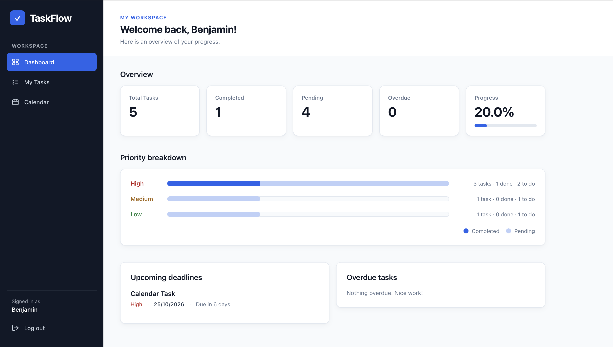
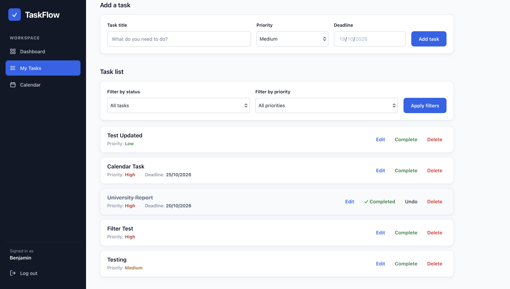
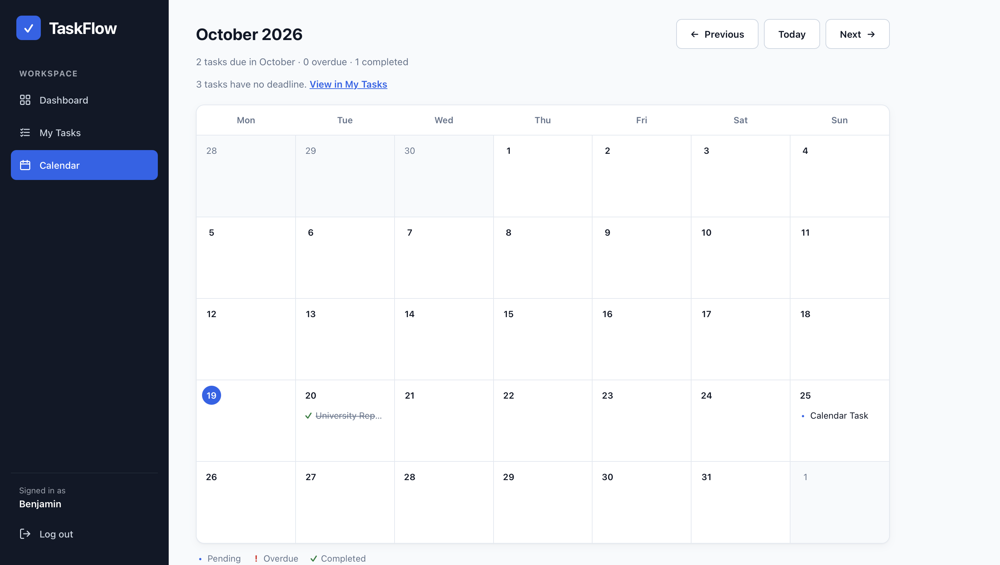
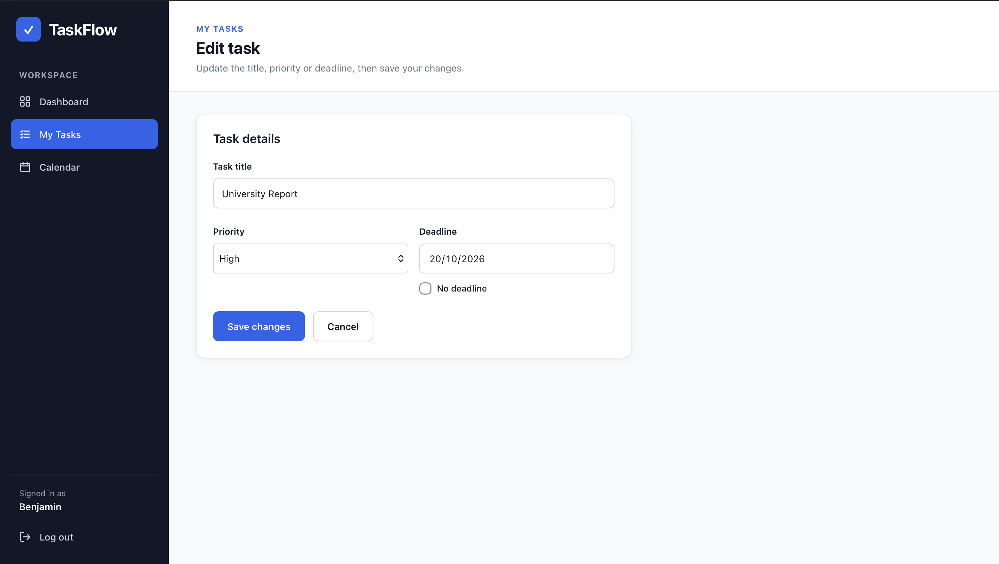
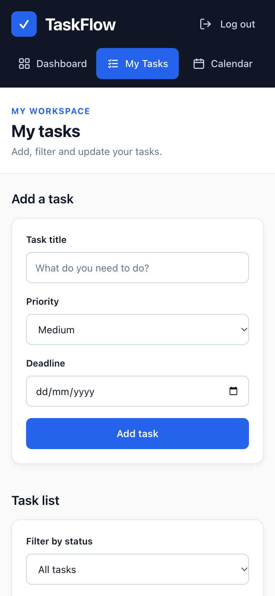

# TaskFlow

TaskFlow is a personal task management web application built with Python, Flask and SQLite. Users can create an account, organise their tasks by priority and deadline, track their progress on a dashboard and plan their work on a monthly calendar.

It was developed for the PFD200 Professional Development module as part of the FdSc Computing programme.

## Contents

- [Features](#features)
- [Screenshots](#screenshots)
- [Technologies](#technologies)
- [Project structure](#project-structure)
- [Getting started](#getting-started)
- [Running the tests](#running-the-tests)
- [Security measures](#security-measures)
- [Current limitations](#current-limitations)
- [Future improvements](#future-improvements)
- [Project author](#project-author)
- [Copyright](#copyright)

## Features

### Accounts

- Register with a name, email address and password. Each email address can only be registered once.
- Log in and log out.
- Passwords are stored as secure hashes, never as plain text.
- Every user only sees and manages their own tasks.

### Dashboard

The dashboard gives a read-only overview of the user's tasks:

- **Statistics:** total, completed, pending and overdue tasks, plus a completion percentage with a progress bar. The overdue count is highlighted when it is above zero.
- **Priority breakdown:** a bar chart, built with HTML and CSS, showing how many High, Medium and Low priority tasks are completed and still to do. The numbers are also written as text next to each bar.
- **Upcoming deadlines:** the five nearest pending deadlines, including tasks due today, with labels such as "Due tomorrow" or "Due in 3 days".
- **Overdue tasks:** up to five overdue tasks, oldest first, with a link to the rest when there are more.

Selecting a task on the dashboard opens it for editing.

### My Tasks

- Add a task with a title (up to 100 characters), a priority and an optional deadline.
- Filter the list by status (all, pending or completed) and by priority.
- Mark tasks as complete, and undo a completion if needed.
- Edit or delete tasks.
- Overdue tasks are clearly labelled.
- After completing, undoing or deleting a task, the selected filters are kept.
- After completing or undoing a task, the page stays at the same scroll position. This uses a small script; without JavaScript the page still works and simply reloads at the top.

### Calendar

- A monthly calendar with weeks starting on Monday, showing each task on its deadline.
- Previous, next and "Today" navigation.
- Today's date is highlighted, and days from the previous and next months are shown in a lighter style.
- Each task shows its status with a symbol: • pending, ! overdue and ✓ completed. Completed tasks are also crossed out.
- Busy days show three tasks, with a "+ N more" control to show the rest.
- A summary of how many tasks are due, overdue and completed in the month.
- Separate notes for tasks that have no deadline and tasks whose saved deadline is not a valid date.
- On a phone, the calendar becomes a list of the days that have tasks.

### Editing a task

- Change a task's title, priority and deadline, or remove the deadline with the "No deadline" option.
- If something is not valid, the form is shown again with a clear message and nothing is saved.
- Save and Cancel return to the page the task was opened from: My Tasks (with its filters), the Calendar (on the same month) or the Dashboard.

### Design and accessibility

- A consistent interface across all pages, with a sidebar on desktop that becomes a top bar on smaller screens.
- Visible focus outlines for keyboard users and a "Skip to main content" link.
- Extra text for screen readers where the meaning would otherwise only be visual, for example task status on the calendar.
- Priority and status are always shown with text or symbols, not only with colour.
- Text colours were chosen with readability in mind. The main text and background colour pairs were checked against the WCAG AA contrast ratio using the colour values in the stylesheets, but a full accessibility audit has not been carried out.

## Screenshots

### Dashboard



The dashboard shows task statistics, a breakdown of tasks by priority, upcoming deadlines and any overdue tasks.

### My Tasks



My Tasks is where tasks are added, filtered, completed, edited and deleted. Completed tasks are crossed out and can be undone.

### Calendar



The calendar shows each task on its deadline. Today's date is highlighted, and symbols show whether a task is pending, overdue or completed.

### Edit Task



A task's title, priority and deadline can be changed, or the deadline removed with the "No deadline" option.

### Mobile layout



On a phone-sized screen, the sidebar becomes a top bar with the navigation links and Log out, and the content is arranged in a single column.

## Technologies

| Technology | Purpose |
| --- | --- |
| Python | Server-side programming language |
| Flask | Web framework for routing, sessions and templates |
| SQLite | Database for users and tasks |
| Jinja2 | HTML templates with automatic escaping |
| HTML and CSS | Page structure, layout and styling |
| JavaScript | A small script that keeps the scroll position on My Tasks |
| Flask-WTF | CSRF protection for forms |
| Werkzeug | Password hashing and verification |
| python-dotenv | Loads the secret key from the `.env` file |
| unittest | Python's built-in testing framework |
| Git and GitHub | Version control and source code hosting |

## Project structure

```text
python-personal-task-manager/
├── app.py                  Flask application: routes, validation and database access
├── requirements.txt        Python dependencies with fixed versions
├── .env.example            Example configuration file (copy to .env)
├── .gitignore              Files that Git should not track
├── docs/
│   └── screenshots/        Screenshots shown in this README
│       ├── dashboard.png
│       ├── my-tasks.png
│       ├── calendar.png
│       ├── edit-task.png
│       └── mobile-layout.png
├── static/
│   ├── style.css           Shared styles and design variables
│   ├── dashboard.css       Styles for the signed-in pages
│   └── preserve-scroll.js  Keeps the scroll position after Complete and Undo
├── templates/
│   ├── base.html           Shared page layout
│   ├── app_base.html       Signed-in layout with the sidebar
│   ├── index.html          Home page
│   ├── login.html          Log in
│   ├── register.html       Create an account
│   ├── dashboard.html      Dashboard
│   ├── tasks.html          My Tasks
│   ├── calendar.html       Calendar
│   └── edit_task.html      Edit Task
└── tests/
    ├── __init__.py         Sets up a temporary database for the tests
    ├── helpers.py          Shared test helpers
    └── test_*.py           Automated tests (83 in total)
```

The SQLite database (`task_manager.db`) and the `.env` file are created locally and are not stored in the repository.

## Getting started

### Requirements

- Python 3 (developed and tested with Python 3.14)
- Git

### Installation

Clone the repository and move into the project folder:

```bash
git clone https://github.com/ben-ekay/python-personal-task-manager.git
cd python-personal-task-manager
```

Create and activate a virtual environment:

```bash
python3 -m venv .venv
source .venv/bin/activate
```

On Windows, activate it with:

```bat
.venv\Scripts\activate
```

Install the dependencies:

```bash
python -m pip install -r requirements.txt
```

### Configuration

The application needs a secret key, which Flask uses to sign session cookies. Copy the example file:

```bash
cp .env.example .env
```

On Windows, use `copy .env.example .env` instead.

Generate a random key:

```bash
python -c "import secrets; print(secrets.token_hex(32))"
```

Open `.env` and replace the placeholder with the generated key:

```text
FLASK_SECRET_KEY=your_generated_key
```

The application will not start without this key. Never share or commit your real `.env` file.

### Running the application

With the virtual environment active, start the development server:

```bash
python -m flask --app app run --debug --port 5001
```

Then open <http://127.0.0.1:5001> in a web browser.

The SQLite database and its tables are created automatically the first time the application starts.

Debug mode is intended for local development only and must not be used on a public server.

## Running the tests

The project includes 83 automated tests written with Python's built-in `unittest` module. From the project folder, with the virtual environment active, run:

```bash
python -m unittest -v
```

The tests cover:

- **Pages and access control:** the separate Dashboard and My Tasks pages, login requirements, filters and redirects.
- **Completing and undoing tasks:** status changes, statistics and filter handling.
- **Dashboard analytics:** statistics, the priority chart, upcoming deadlines and overdue tasks, including invalid and impossible dates.
- **Calendar:** the month grid, task placement, status rules, navigation and invalid month or year values.
- **Editing and validation:** title, priority and deadline rules for both adding and editing tasks, and safe return navigation.
- **Security:** CSRF protection, access to other users' tasks, and escaping of user content.

The tests use a temporary database outside the project folder, which is deleted afterwards. They never open `task_manager.db`, and they do not need a `.env` file. CSRF protection stays enabled during testing.

The interface was also checked manually in Safari on a desktop computer. JavaScript behaviour, layouts on phones and tablets, and other web browsers have not been fully tested.

## Security measures

- **Password hashing:** passwords are hashed with Werkzeug before they are stored.
- **Authentication:** every private page checks that the user is logged in and redirects to the login page if not.
- **Task ownership:** every database query that reads or changes tasks is limited to the logged-in user, so users cannot view, edit or delete other users' tasks.
- **SQL injection protection:** all database queries use parameterised SQL.
- **CSRF protection:** every form that changes data includes a CSRF token, and these changes only accept POST requests.
- **Server-side validation:** task titles must be 1 to 100 characters, the priority must be High, Medium or Low, and a deadline must be empty or a real date between 1900 and 2200. Values in the address bar, such as calendar months and filters, are checked as well.
- **No open redirects:** after editing a task, the return page is chosen from a fixed list of TaskFlow pages and the address is built by Flask, so a link cannot send users to another website.
- **Output escaping:** Jinja automatically escapes user content such as task titles, which protects against cross-site scripting (XSS).
- **Secret management:** the secret key is kept in `.env`, outside the source code. The `.env` file and the database are excluded from Git, and `.env.example` shows the expected format.

## Current limitations

- Registration does not check password strength or the format of the name and email on the server; only the browser's built-in checks apply.
- Registration and login errors are shown as plain text pages rather than on the form.
- There is no limit on the number of failed login attempts.
- Logging out uses a normal link (a GET request) rather than a form.
- There is no password reset, account deletion or profile editing.
- Database changes are made by checks when the application starts, rather than by migration scripts.
- SQLite and the Flask development server are suitable for local use, not for a public deployment.
- Deadlines are dates only, based on the server's local date. Times and time zones are not supported.
- The task list has no search or pagination. Newest tasks are shown first.
- The calendar covers the years 1900 to 2200.
- The automated tests do not cover JavaScript, the visual layout or different browsers. The interface has only been checked manually in Safari on a desktop computer, so behaviour on other browsers, phones and tablets has not been fully tested.

## Future improvements

- Add server-side validation and on-page error messages for registration and login.
- Change logout to use a POST form.
- Limit repeated failed login attempts.
- Add password reset by email.
- Add search and pagination to My Tasks.
- Add reminders for upcoming deadlines.
- Use migration scripts to manage database changes.
- Deploy with a production web server behind HTTPS, with secure session cookies.
- Run the automated tests on every push using GitHub Actions.
- Add browser-based tests for the interface.

## Project author

TaskFlow was developed by Benjamin Ekay Gabilondo, the student developer, for the Professional Development (PFD200) mini-project on the FdSc Computing programme.

- **Name:** Benjamin Ekay Gabilondo
- **Course:** FdSc Computing
- **Module:** PFD200 — Professional Development
- **Year:** 2026

## Copyright

Copyright (c) 2026 Benjamin Ekay Gabilondo. All rights reserved.
